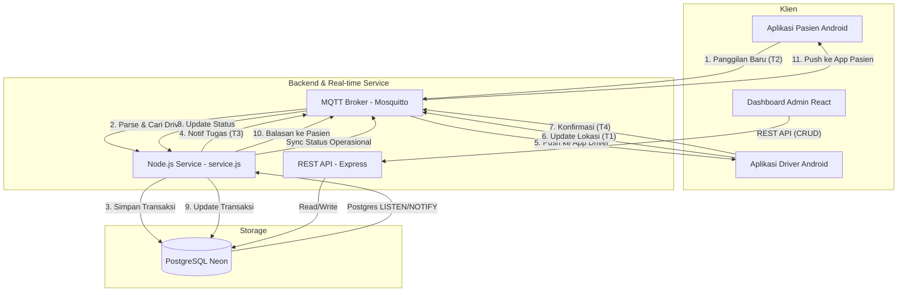

# Dokumentasi Data Pipeline: Sistem Manajemen Ambulans

Dokumen ini memetakan seluruh aliran data (data pipeline) pada sistem, termasuk interaksi antara Database PostgreSQL, REST API Express, dan layanan MQTT Real-time.

## 1. Arsitektur Aliran Data (High-Level Architecture)

## 2. Model Data & Skema Database

Sistem ini memiliki 3 entitas (model) utama yang dikelola oleh Sequelize di PostgreSQL.

### Tabel `Ambulans`
Menyimpan data pendaftaran dan status operasional armada.
*   **id_ambulans**: Integer, Primary Key (Auto Increment).
*   **nomor_polisi**, **nama_driver**, **nik**, **email**, **nomor_telepon**: String.
*   **kategori_armada**: Enum (`PSC`, `Relawan`). Digunakan dalam algoritma *dispatch* hybrid.
*   **status_akun**: Enum (`pending`, `active`, `rejected`).
*   **status_operasional**: Enum (`available`, `busy`, `offline`). Diperbarui via MQTT atau REST API.
*   **lokasi_latitude**, **lokasi_longitude**: Decimal. Diperbarui secara *real-time* via MQTT.

### Tabel `Pasien`
Menyimpan data pengguna pencari bantuan.
*   **id_pasien**: Integer, Primary Key.
*   **nik**, **nama**, **tgl_lahir**, **jenis_kelamin**, **foto_ktp**: Data demografi & verifikasi.

### Tabel `Transaksi` (Panggilan)
Tabel riwayat seluruh pesanan ambulans.
*   **id_panggilan**: Integer, Primary Key.
*   **id_pasien**: Foreign Key ➔ `Pasien`.
*   **id_ambulans_respons**: Foreign Key ➔ `Ambulans`. (Bisa NULL jika belum dapat driver).
*   **jenis_layanan**: String (`DARURAT`, `TRANSPORT`, dll).
*   **kondisi**: String. Kondisi/Keluhan dari pasien.
*   **lokasi_pasien_lat**, **lokasi_pasien_lon**: Double (Koordinat TKP).
*   **status_panggilan**: Enum (`PENDING`, `ACCEPTED`, `ON_THE_WAY`, `COMPLETED`, `CANCELLED`).

---

## 3. Dokumentasi Protokol Real-Time (MQTT)

MQTT adalah tulang punggung operasional. Terdapat beberapa topik Pub/Sub yang berjalan pada Node Service (`service.js`).

### A. Dari Klien ke Server (Subscribed by Node.js)

| Kode | Topik MQTT | Publisher | Payload JSON | Deskripsi |
| :--- | :--- | :--- | :--- | :--- |
| **T2** | `panggilan/masuk` | App Pasien | `{ "id_pasien": 1, "lokasi_pasien_lat": -6.2, "lokasi_pasien_lon": 106.8, "jenis_layanan": "DARURAT", "kondisi": "Pendarahan" }` | Panggilan ambulans baru. Server akan mencari armada dengan *Haversine* & Google Maps API. |
| **T1** | `ambulans/lokasi/update/{id}` | App Driver | `{ "lokasi_latitude": -6.21, "lokasi_longitude": 106.81 }` | Update GPS berkala. Jika status `offline`, akan diubah menjadi `available`. |
| **T4** | `ambulans/respons/konfirmasi` | App Driver | `{ "id_panggilan": 12, "id_driver": 5, "status": "diterima" }` | Driver merespons tawaran tugas. Status bisa `diterima`, `ditolak`, atau `selesai`. |
| **-** | `ambulans/status/update` | App Driver | `{ "id_ambulans": 5, "status": "AVAILABLE" }` | Update manual status kesiapan (Siaga/Sibuk/Offline). |
| **-** | `panggilan/batal/pasien` | App Pasien | `{ "id_panggilan": 12, "id_pasien": 1 }` | Pasien membatalkan pesanan. |

### B. Dari Server ke Klien (Published by Node.js)

| Kode | Topik MQTT | Subscriber | Payload JSON | Deskripsi |
| :--- | :--- | :--- | :--- | :--- |
| **T3** | `ambulans/tugas/{id_ambulans}` | App Driver | `{ "id_panggilan": 12, "id_pasien": 1, "nama_pasien": "Budi", "lokasi_pasien_lat": -6.2, "lokasi_pasien_lon": 106.8, "eta_detik": 300, "kondisi": "Pendarahan" }` | Notifikasi tawaran tugas ke armada terdekat/tercepat. Ada *timeout* 20 detik sebelum dialihkan. |
| **T8** | `panggilan/status/pasien/{id_pasien}`| App Pasien | `{ "status_panggilan": "menuju_lokasi", "id_panggilan": 12, "id_ambulans": 5, "eta_detik": 0 }` | Balasan/Update status untuk HP Pasien (misal: "menuju_lokasi", "selesai", atau "ditolak"). |
| **-** | `ambulans/interupsi/batal/{id}` | App Driver | `{ "pesan": "Pasien membatalkan pesanan..." }` | Sinyal paksa untuk membatalkan dering telepon/tugas di HP Driver. |
| **-** | `ambulans/status/sinkronisasi/{id}` | App Driver | `{ "id_ambulans": 5, "status_baru": "BUSY" }` | Sinyal *Push* dari DB (melalui trigger Postgres) agar state UI aplikasi driver sinkron. |

---

## 4. Dokumentasi REST API (Admin Panel)

API berikut digunakan oleh Dashboard React Admin (`api.js`). Memerlukan autentikasi (*session/cookie* `cekLoginAPI`).

### Auth & Akun
*   `POST /api/admin/login`: Login Admin Dashboard.
*   `POST /api/admin/logout`: Logout Admin.
*   `GET /api/admin/me`: Mengambil sesi Admin saat ini.
*   `POST /api/admin/register`: Pendaftaran driver baru (menerima upload foto `foto_ambulans` menggunakan Multer).

### Monitoring & Dashboard
*   `GET /api/admin/dashboard`: Statistik jumlah ambulans, pasien, dan transaksi.
*   `GET /api/admin/monitor`: Mengambil titik lokasi seluruh ambulans untuk *live map tracking*.

### Master Data: Ambulans & Pasien
*   `GET /api/admin/ambulans`: Mengambil seluruh list ambulans.
*   `GET /api/admin/ambulans/:id`: Mengambil detail satu ambulans.
*   `PUT /api/admin/ambulans/:id`: Mengupdate data ambulans.
*   `PUT /api/admin/verify/:id`: Memverifikasi pendaftaran akun driver (mengubah status `pending` ➔ `active`).
*   `GET /api/admin/pasien` & `PUT /api/admin/pasien/:id`: Endpoint pengelolaan akun pasien.

---

## 5. Lifecycle Panggilan (The Dispatch Machine)

1.  **Pencarian (T2):** Pasien mengirim `panggilan/masuk`. `service.js` membuat `Transaksi` di DB (Status: `PENDING`).
2.  **Filter & Refine:** Server mencari `Ambulans` dengan status `AVAILABLE` terdekat via Haversine, lalu mengecek ETA tercepat via Google Maps Distance Matrix API.
3.  **Tawaran Tugas (T3):** Server mengubah status Transaksi menjadi `WAITING_FOR_DRIVER`, lalu *publish* ke `ambulans/tugas/{id}`. Ada timer `setTimeout` 20 detik.
4.  **Respon Driver (T4):**
    *   **Diterima:** Transaksi menjadi `ON_THE_WAY`, Ambulans menjadi `BUSY`. Server *publish* notifikasi ke Pasien.
    *   **Ditolak / Timeout:** Driver dimasukkan ke *Blacklist* memori. Server kembali ke Langkah 2 mencari kandidat pengganti.
5.  **Penyelesaian (T4/Batal):** 
    *   Jika driver klik selesai, Transaksi menjadi `COMPLETED`, Ambulans `AVAILABLE`.
    *   Jika pasien membatalkan (`panggilan/batal/pasien`), server mengirim sinyal "Interupsi Batal" ke Driver. Ambulans kembali `AVAILABLE`. Transaksi menjadi `CANCELLED`.
